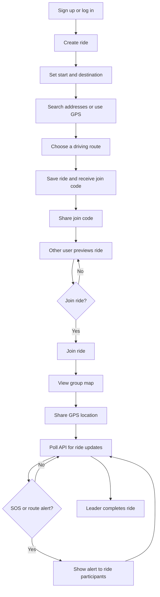
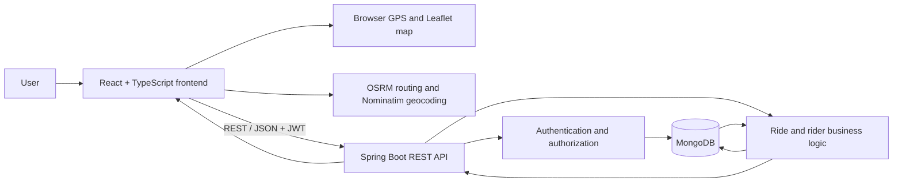

# Rider Route

**Plan a group ride, invite riders, and stay coordinated on the road.**

Rider Route is a personal full-stack project for coordinating shared journeys. A ride leader creates a route and shares a short join code. Other signed-in users can preview and join the ride, then see the planned route and participating riders on a map. Riders can share their GPS location, send an SOS, and alert a fellow rider who may be off route.

The application has a React and TypeScript frontend, a Java and Spring Boot REST API, and MongoDB persistence.

## Features

- **Account authentication:** sign up and log in with JWTs; passwords are hashed with BCrypt.
- **Ride planning:** search addresses, use the current location, compare driving routes, and save the selected route with its distance and duration.
- **Ride invitations:** share a join code; invitees can preview the ride before choosing to join.
- **Group tracking:** view the planned route and participating riders on a Leaflet map, with browser GPS location sharing.
- **Independent rider participation:** an individual rider can leave or hide a ride without ending it for the group.
- **Safety tools:** SOS alerts with location, route-to-SOS support, and wrong-route alerts.
- **Concurrent ride updates:** MongoDB optimistic locking with a bounded retry when mutating shared ride data.

## User flow



## Architecture



The frontend communicates with the backend over HTTP. The ride view polls for updates approximately every two seconds, while location updates are sent periodically. This version uses REST polling rather than WebSockets.

## Technology stack

| Layer | Technologies |
|---|---|
| Frontend | React 18, TypeScript, Vite |
| UI | Tailwind CSS, Radix UI / shadcn-style components, Lucide |
| Maps and geolocation | Leaflet, React Leaflet, browser Geolocation API |
| Route and address services | OSRM for driving routes; Nominatim for geocoding |
| Client state and navigation | Zustand, TanStack React Query, React Router |
| Backend | Java 17, Spring Boot 3, Spring Web, Bean Validation |
| Persistence | Spring Data MongoDB, MongoDB |
| Authentication | JWT, BCrypt |
| Local database setup | Docker Compose |
| Testing | Vitest, Testing Library, JUnit 5, Spring Boot Test |

## Repository layout

```text
.
├── frontend/                     React + TypeScript application
│   └── src/
│       ├── pages/                Screens and user flows
│       ├── components/            UI, ride, and map components
│       ├── services/              API, routing, location, and journey logic
│       └── store/                 Client-side auth and ride state
├── backend/                      Spring Boot application
│   └── src/
│       ├── main/.../controller/   REST endpoints
│       ├── main/.../service/      Business logic
│       ├── main/.../model/        MongoDB documents and domain state
│       ├── main/.../repository/   MongoDB repositories
│       └── test/                  Backend tests
└── package.json                  Root scripts forwarding to frontend
```

## Run locally

### Prerequisites

- Node.js and npm
- JDK 17+
- Docker Desktop with Docker Compose, or another MongoDB instance

### 1. Start MongoDB

From the `backend` directory:

```bash
docker compose up -d
```

This starts MongoDB on `localhost:27017` and persists its data in a Docker volume.

### 2. Configure and start the backend

The backend reads its MongoDB URI and JWT signing key from environment variables. The MongoDB URI defaults to the local Docker database. **`JWT_SECRET` must be set** to a private, Base64-encoded key of at least 256 bits. Never commit your actual secret.

#### Windows PowerShell

```powershell
$bytes = New-Object byte[] 32
$rng = [System.Security.Cryptography.RandomNumberGenerator]::Create()
$rng.GetBytes($bytes)
$env:JWT_SECRET = [Convert]::ToBase64String($bytes)
$rng.Dispose()

$env:MONGODB_URI = "mongodb://localhost:27017/rider_route"
$env:CORS_ALLOWED_ORIGINS = "http://localhost:8080"
$env:JWT_EXPIRATION_DAYS = "30"

cd backend
.\mvnw.cmd spring-boot:run
```

#### macOS / Linux

```bash
export JWT_SECRET="$(openssl rand -base64 32)"
export MONGODB_URI="mongodb://localhost:27017/rider_route"
export CORS_ALLOWED_ORIGINS="http://localhost:8080"
export JWT_EXPIRATION_DAYS="30"

cd backend
./mvnw spring-boot:run
```

Run the backend from the same terminal where you set these variables. The example commands generate a secret for that terminal session; changing the secret invalidates previously issued JWTs. Keep a private secret securely if you want sessions to remain valid across backend restarts.

The backend listens at `http://localhost:8083`; the API base URL is `http://localhost:8083/api`.

| Environment variable | Purpose | Default |
|---|---|---|
| `MONGODB_URI` | MongoDB connection URI | `mongodb://localhost:27017/rider_route` |
| `JWT_SECRET` | Base64-encoded key used to sign JWTs | Required; no committed default |
| `JWT_EXPIRATION_DAYS` | JWT lifetime in days | `30` |
| `CORS_ALLOWED_ORIGINS` | Comma-separated allowed frontend origins | `http://localhost:8080,http://localhost:5173` |

`backend/.env.example` documents the expected variables. Spring Boot does not automatically load a plain `.env` file. Export variables in your shell, configure them in your IDE, or use a development tool that explicitly loads the file. Keep real secrets in an untracked local environment file or a secret manager.

### 3. Start the frontend

In a second terminal:

```bash
cd frontend
npm install
npm run dev
```

Open `http://localhost:8080`. The frontend defaults to `http://localhost:8083/api`. To use another backend URL, set `VITE_API_BASE_URL` in `frontend/.env`:

```dotenv
VITE_API_BASE_URL=http://localhost:8083/api
```

After installing frontend dependencies, root-level scripts are also available:

```bash
npm run dev
npm test
npm run build
```

## Tests and checks

Run frontend tests and create a production build from the repository root:

```bash
npm test
npm run build
```

Run backend tests from `backend`:

```powershell
.\mvnw.cmd test
```

On macOS or Linux:

```bash
./mvnw test
```

The backend concurrency integration test uses a local MongoDB instance at `localhost:27017`; it skips the database-dependent test when MongoDB is unavailable.

## API overview

All endpoints are under `/api`. Authenticated endpoints expect a bearer token in the `Authorization` header.

### Authentication

| Method | Endpoint | Description |
|---|---|---|
| `POST` | `/auth/signup` | Create an account and return a JWT |
| `POST` | `/auth/login` | Authenticate and return a JWT |
| `GET` | `/auth/me` | Get the current user's profile |

### Rides

| Method | Endpoint | Description |
|---|---|---|
| `POST` | `/rides` | Create a ride |
| `GET` | `/rides` | List the current user's rides |
| `GET` | `/rides/user/{userId}` | List rides for the authenticated user |
| `GET` | `/rides/{rideId}` | Get ride details |
| `GET` | `/rides/by-code/{code}` | Preview a ride by join code |
| `PUT` | `/rides/{rideId}` | Edit ride details (leader only) |
| `POST` | `/rides/{rideId}/join` | Join a ride |
| `PATCH` | `/rides/{rideId}/riders/{userId}/location` | Update a rider's location |
| `POST` | `/rides/{rideId}/riders/{userId}/close` | Close participation for one rider |
| `PATCH` | `/rides/{rideId}/status?status=ACTIVE` | Change ride status (leader only) |
| `DELETE` | `/rides/user/{userId}/history/{rideId}` | Hide a ride from the user's history |
| `POST` | `/rides/{rideId}/sos` | Trigger an SOS during an active ride |
| `POST` | `/rides/{rideId}/sos/cancel` | Cancel the sender's active SOS |
| `POST` | `/rides/{rideId}/riders/{userId}/wrong-route-alert` | Notify a rider of a route concern |

Ride status values are `WAITING`, `ACTIVE`, and `COMPLETED`.

## Engineering notes

- **Ride and rider state are separate:** completing the overall ride differs from one participant closing or hiding their own participation.
- **Optimistic concurrency:** ride documents use Spring Data MongoDB versioning. Service mutations reload and retry after optimistic-lock conflicts, with a maximum of three attempts.
- **Location handling:** leaving or hiding participation clears that rider's stored location.
- **Distance and ETA:** route distance and duration are saved with the ride. Older rides without totals can use route geometry and an explicitly approximate 30 km/h estimate. Estimates do not account for live traffic or stops.
- **External services:** routing and geocoding use public OSRM and Nominatim services. Their availability, usage policies, and response times are outside this application's control.

## Scope and limitations

- Ride updates use periodic HTTP polling rather than a persistent real-time connection.
- Route estimates do not incorporate live traffic.
- This is a personal project; no production deployment, operational scale, or service-level guarantees are claimed.
